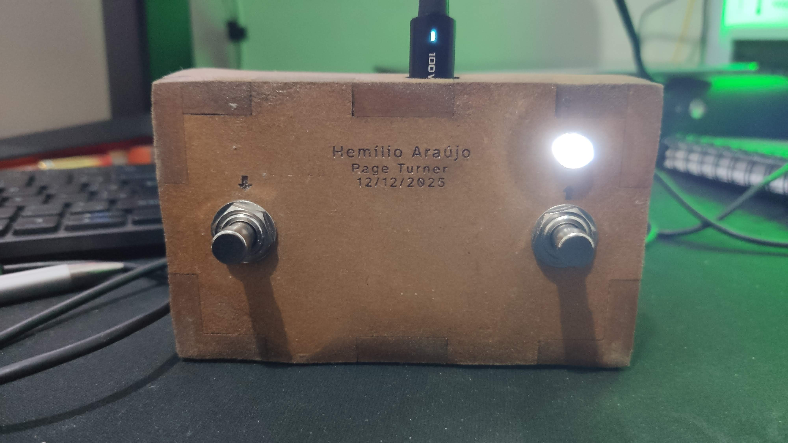
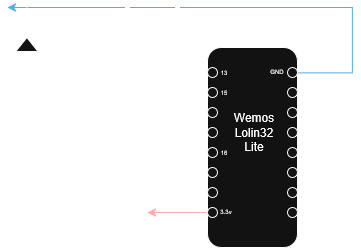

# PageTurnerMIDI - DIY Bluetooth MIDI Page Turner

**PageTurnerMIDI** is a DIY wireless page turner pedal for musicians. It uses an ESP32 microcontroller to transmit MIDI signals via Bluetooth Low Energy (BLE), allowing you to turn pages in apps like MobileSheets, forScore, and others that support MIDI mapping.



## ✨ Features

* **Wireless Connectivity:** Uses BLE MIDI for low latency and cable-free operation.
* **Dual Pedal Control:**
  * **DOWN Button:** Sends MIDI Note **(69)**.
  * **UP Button:** Sends MIDI Note **(70)**.
* **Status Indication:** LED indicator for connection status (Blinking = Waiting, Solid = Connected).
* **Reboot Function:** Hold both pedals simultaneously for 5 seconds to restart the device.
* **Custom Enclosure:** Laser-cut design files included for 9mm material.

## 🛠️ Hardware & Pinout

The project is built around an **ESP32** development board.

| Component | ESP32 Pin (GPIO) | Description |
| :--- | :--- | :--- |
| **Button DOWN** | 13 | Sends Note **69** (Next Page typically) |
| **Button UP** | 15 | Sends Note **70** (Previous Page typically) |
| **Status LED** | 16 | Visualization of connection state |

### Circuit Diagram

You can find the detailed circuit diagram in the `diagram/` folder.
Obs.: It was used a 100 ohm resistor for the LED, it could change according to the LED used.



## 📦 Enclosure / Case

The `laser-cut/` folder contains the design files for the pedal enclosure (Obs.: It was used a 9mm material).

* `page-turner.svg`: Vector file for laser cutting.
* `pedal-page-turner.lbrn2`: LightBurn project file.

## 📚 Software Dependencies

To compile the firmware using **Arduino IDE** or **PlatformIO**, the following libraries are required:

| Library / Package | Description | Required? |
| :--- | :--- | :--- |
| **[ESP32 Board Package](https://github.com/espressif/arduino-esp32)** | Core ESP32 board support for Arduino/PlatformIO | **Yes** |
| **[Control Surface](https://github.com/tttapa/Control-Surface)** (by Pieter P / tttapa) | MIDI events handling, BLE MIDI interface, and debounced button reading | **Yes** |
| **[NimBLE-Arduino](https://github.com/h2zero/NimBLE-Arduino)** (by h2zero) | Lightweight Bluetooth stack to save ESP32 RAM and Flash memory | *Optional* (when using `#define CS_USE_NIMBLE`) |

### How to install:
* **Arduino IDE:** Open the Library Manager (`Ctrl + Shift + I`) and search for **Control Surface** (and optionally **NimBLE-Arduino**).
* **PlatformIO (`platformio.ini`):**
  ```ini
  lib_deps =
      tttapa/Control Surface @ ^1.2.0
      ; h2zero/NimBLE-Arduino @ ^1.4.2 ; Uncomment if enabling CS_USE_NIMBLE
  ```

## 🚀 Installation & Usage

1. **Hardware Assembly:** Follow the circuit diagram to connect the buttons and LED to your ESP32.
2. **Upload Firmware:**
    * Open the project in PlatformIO or Arduino IDE.
    * Make sure you installed the dependencies listed above.
    * Upload `src/PageTurnerMidi.ino` to your ESP32.
3. **Pairing:**
    * Power on the pedal. The LED should blink.
    * On your tablet/computer, search for Bluetooth devices.
    * Connect to **"PT-MIDI"** (configured via `DEVICE_NAME` constant). The LED will stay solid ON.
    * *(Android note: see troubleshooting section below if the device does not appear).*
4. **App Configuration:**
    * Open your sheet music app (e.g., MobileSheets).
    * Go to MIDI Settings.
    * Map MIDI Note **69** to "Scroll Down" or "Next Page".
    * Map MIDI Note **70** to "Scroll Up" or "Previous Page".

## 📱 Android Troubleshooting (Device Not Found)

If **PT-MIDI** does not appear when scanning for devices inside your sheet music app (e.g., MobileSheets, SongbookPro), this is usually due to Android's **Location (GPS)** requirements for Bluetooth Low Energy (BLE) scanning.

### 🛠️ How to fix:
1. **Turn ON Location (GPS)** in your Android quick settings.
2. **Grant Location permission** to your sheet music app (`Settings > Apps > [Your App] > Permissions`).

### 📋 Behavior by Android Version:

| Android Version | Requires Location Permission? | Requires Location/GPS Turned ON? |
| :--- | :--- | :--- |
| **Android 5.1 and earlier** | No (install-time permission) | No |
| **Android 6.0 to Android 11** *(e.g. Oreo 8.0/8.1)* | **Yes** (`ACCESS_FINE_LOCATION`) | **Yes** (devices are hidden if GPS is off) |
| **Android 12 and newer** | **Yes** (`BLUETOOTH_SCAN`) | **No** (for most updated apps) |

> **Note:** On devices running Android 6.0 through 11, the operating system hides nearby BLE devices if GPS is turned off or if location permissions have not been granted to the app.
