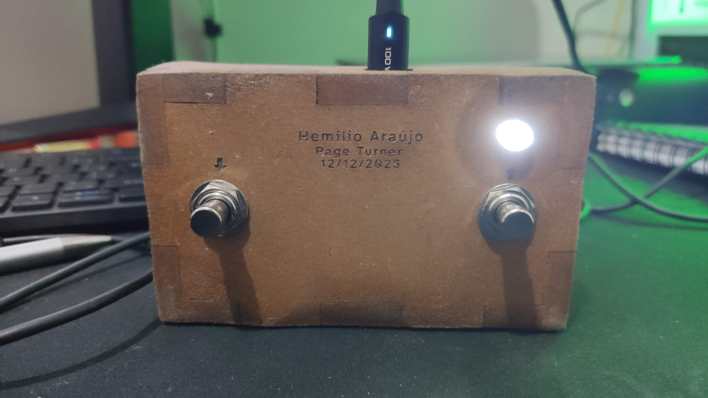
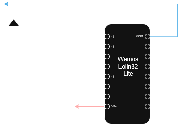

# PageTurnerMIDI - Pedal Passador de Páginas Bluetooth DIY

**PageTurnerMIDI** é um pedal passador de páginas sem fio "faça-você-mesmo" para músicos. Ele utiliza um microcontrolador ESP32 para transmitir sinais MIDI via Bluetooth Low Energy (BLE), permitindo virar páginas em aplicativos como MobileSheets, forScore e outros que suportam mapeamento MIDI.



## ✨ Funcionalidades

* **Conectividade Sem Fio:** Usa MIDI via BLE para baixa latência e operação sem cabos.
* **Controle Duplo:**
  * **Botão DOWN (Baixo):** Envia Nota MIDI **(69)**.
  * **Botão UP (Cima):** Envia Nota MIDI **(70)**.
* **Indicação de Status:** LED indicador de conexão (Piscando = Aguardando, Aceso = Conectado).
* **Função de Reinício:** Segure ambos os pedais simultaneamente por 5 segundos para reiniciar o dispositivo.
* **Gabinete Personalizado:** Arquivos para corte a laser incluídos.

## 🛠️ Hardware e Pinagem

O projeto é construído em torno de uma placa de desenvolvimento **ESP32**.

| Componente | Pino ESP32 (GPIO) | Descrição |
| :--- | :--- | :--- |
| **Botão DOWN** | 13 | Envia Nota **69** (Geralmente Próxima Página) |
| **Botão UP** | 15 | Envia Nota **70** (Geralmente Página Anterior) |
| **LED de Status** | 16 | Visualização do estado da conexão |

### Diagrama do Circuito

Você pode encontrar o diagrama detalhado do circuito na pasta `diagram/`.  
Obs.: Foi usado um resistor de 100 ohm para o LED, pode variar dependendo do LED usado.



## 📦 Gabinete / Case

A pasta `laser-cut/` contém os arquivos de design para o gabinete do pedal (Obs.: Foi usado um material de 9mm).

* `page-turner.svg`: Arquivo vetorial para corte a laser.
* `pedal-page-turner.lbrn2`: Arquivo de projeto do LightBurn.

## 📚 Dependências de Software

Para compilar o firmware no **Arduino IDE** ou **PlatformIO**, as seguintes bibliotecas são necessárias:

| Biblioteca / Pacote | Descrição | Obrigatória? |
| :--- | :--- | :--- |
| **[ESP32 Board Package](https://github.com/espressif/arduino-esp32)** | Suporte básico à arquitetura ESP32 no Arduino/PlatformIO | **Sim** |
| **[Control Surface](https://github.com/tttapa/Control-Surface)** (por Pieter P / tttapa) | Gerenciamento de eventos MIDI, interface BLE MIDI e leitura de botões com debounce | **Sim** |
| **[NimBLE-Arduino](https://github.com/h2zero/NimBLE-Arduino)** (por h2zero) | Pilha Bluetooth leve para economia de memória RAM e Flash | *Opcional* (para uso com `#define CS_USE_NIMBLE`) |

### Como instalar:
* **Arduino IDE:** Abra o Gerenciador de Bibliotecas (`Ctrl + Shift + I`) e pesquise por **Control Surface** (e opcionalmente **NimBLE-Arduino**).
* **PlatformIO (`platformio.ini`):**
  ```ini
  lib_deps =
      tttapa/Control Surface @ ^1.2.0
      ; h2zero/NimBLE-Arduino @ ^1.4.2 ; Descomente caso utilize CS_USE_NIMBLE
  ```

## 🚀 Instalação e Uso

1. **Montagem do Hardware:** Siga o diagrama do circuito para conectar os botões e o LED ao seu ESP32.
2. **Upload do Firmware:**
    * Abra o projeto no PlatformIO ou Arduino IDE.
    * Certifique-se de ter instalado as dependências listadas acima.
    * Faça o upload do `src/PageTurnerMidi.ino` para o seu ESP32.
3. **Pareamento:**
    * Ligue o pedal. O LED deve piscar.
    * No seu tablet/computador, procure por dispositivos Bluetooth.
    * Conecte-se a **"PT-MIDI"** (definido pela constante `DEVICE_NAME`). O LED ficará aceso fixo.
    * *(Nota para Android: veja a seção de solução de problemas abaixo caso o dispositivo não apareça).*
4. **Configuração do App:**
    * Abra seu aplicativo de partituras (ex: MobileSheets).
    * Vá para as Configurações MIDI.
    * Mapeie a Nota MIDI **69** para "Rolar para Baixo" ou "Próxima Página".
    * Mapeie a Nota MIDI **70** para "Rolar para Cima" ou "Página Anterior".

## 📱 Solução de Problemas no Android (Dispositivo não aparece)

Se o **PT-MIDI** não aparecer na busca dentro do seu aplicativo (ex: SongbookPro, MobileSheets), isso geralmente ocorre devido às regras de **Localização (GPS)** que o Android exige para escanear dispositivos Bluetooth Low Energy (BLE).

### 🛠️ O que fazer:
1. **Ative a Localização (GPS)** do aparelho nas configurações rápidas do Android.
2. **Conceda permissão de Localização** para o seu aplicativo de música/partitura (`Configurações > Aplicativos > [Seu App] > Permissões`).

### 📋 Resumo por versão do Android:

| Versão do Android | Exige Permissão de Localização? | Exige GPS/Localização Ligado no Sistema? |
| :--- | :--- | :--- |
| **Android 5.1 ou anterior** | Não (permissão na instalação) | Não |
| **Android 6.0 a Android 11** *(ex: Oreo 8.0/8.1)* | **Sim** (`ACCESS_FINE_LOCATION`) | **Sim** (o pedal não é listado se o GPS estiver desligado) |
| **Android 12 em diante** | **Sim** (`BLUETOOTH_SCAN`) | **Não** (na maioria dos aplicativos atualizados) |

> **Observação:** Em aparelhos com Android 6.0 a 11, o sistema operacional oculta os dispositivos BLE caso o GPS esteja desligado ou o app não tenha permissão de localização.
